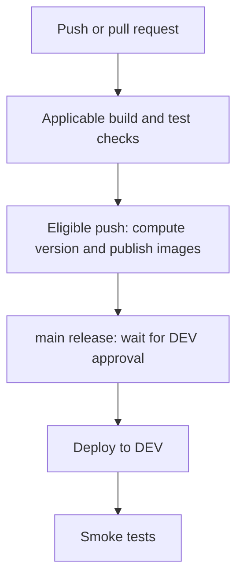
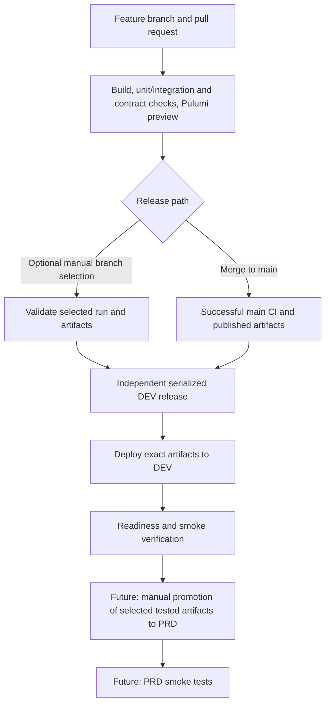

# Deployment Workflow

Status updated on 2026-10-26. The diagrams distinguish deployed behaviour
from the accepted direction in
[ADR 0006](architecture/decisions/0006-separate-dev-validation-and-deployment.md).

## Previous Deployed Flow and Cutover

Before this increment, the single CI workflow performed validation, publication, DEV deployment, and
smoke checks. Push and pull-request triggers exist, but image build/publication
and Docker integration tests are push-gated. `main` deployment references the
GitHub `dev` environment, currently configured for manual approval. Superseding
runs could cancel the whole CI workflow, including deployment. PR #163 separates
these lifecycles. CI is reported green for the pushed changes; independent
delivery, partial-rerun recovery, and queue behaviour still require execution
evidence before the cutover is considered verified.

The approval rule was used to stop old replicas before the incompatible table
move in release `0.17.4`; it is not general automatic maintenance. That operation
is recorded in [ADR 0005](architecture/decisions/0005-least-privileged-game-state-database-access.md).

## Target State

The target check list is not a claim that contract gating or Pulumi preview is
already wired for every PR. Identify missing checks explicitly during delivery.

## Delivery Boundaries

| Story | Responsibility |
| --- | --- |
| DEV deployment alignment | Independent protected deployment/verification lifecycle, optional authorized branch release, automatic main release, artifact provenance, serialization, shared-schema policy |
| Cost assessment | Estimate permanent/temporary environment costs and realistic scheduling savings |
| DEV cost control | Future configurable nightly shutdown in Europe/London, wake on deployment or manual request, one-hour deployment grace, time-limited keep-awake, shutdown coordination; no scheduled morning wake |
| Isolated environments | Separate stable PRD resources, database, credentials, and Pulumi stack |
| Release promotion | Deliberately select and promote the same tested artifact identities to PRD without rebuilding |
| Upgrade and recovery rehearsal | Repeat upgrades from the previous release with representative data in a disposable environment |
| Reusable maintenance | Automate proven procedures for incompatible schema changes when justified |

Feature environments are outside the initial shared-DEV scope. PRD and scheduled
operating hours do not exist yet. Key Vault and a dedicated migrator account
are separate security increments.

PRD is deferred while its costs and operating expectations are refined. Key
Vault and a dedicated migrator account can be prioritized ahead of it.

## Release Artifacts and Partial Reruns

CI publishes one digest-based receipt for each API, migrator, and provisioner
image. Receipts retain their CI run ID, source commit, version, role, and
producing attempt. A partial rerun may legitimately combine receipts from
different attempts of the same run.

- Download `release-image-*` artifacts into separate directories, preserving
  earlier receipts rather than overwriting files with the same name. Check each
  receipt against its artifact directory name.
- Validate all receipts against the selected run, commit, version, registry,
  and digest format. Select the highest numeric attempt per role; require all
  three roles. Reject future attempts and duplicate role/attempt pairs.
- The combined manifest records its own producing `run_attempt`, immutable
  `images`, and per-role `image_attempts`. Validate that provenance contains
  exactly the required roles and positive integer strings no newer than the
  manifest attempt.
- Delivery selects the highest available manifest attempt up to the selected
  CI run's current attempt. Validate the manifest against that artifact's
  producing attempt, not necessarily the latest CI attempt. This permits an
  unrelated failed job to be rerun without republishing a successful manifest.
- Reject duplicate manifests at the selected attempt, future attempts, and an
  expired selected manifest. Missing manifests skip automatic delivery and fail
  an explicit manual selection; there is no fallback to mutable image tags.

## DEV Queue Policy

The independent delivery workflow uses `delivery-dev`,
`cancel-in-progress: false`, and `queue: max`. The boundary includes selection,
deployment, and smoke verification. New runs do not replace pending requests;
GitHub permits up to 100 pending runs, with additional requests cancelled when
the queue is full. See [GitHub concurrency configuration](https://docs.github.com/en/actions/how-tos/write-workflows/choose-when-workflows-run/control-workflow-concurrency).

Non-deployable candidates can still wait in the queue, then skip or fail during
selection. Queue admission order is not a promise of source-commit order.
Automatic releases must still match current `main` during selection and again
before the infrastructure update after environment approval. Explicit manual
selection may choose a validated branch release.

## Remaining Execution Evidence

Passing CI establishes the script tests and publication path, not all delivery
behaviour. Record the following checks before resolving the corresponding
review findings:

- Recover a failed publisher with only failed jobs rerun; assemble the manifest
  from the successful receipts across attempts.
- Rerun an unrelated failed job after a manifest was produced; discover and
  validate the earlier manifest when CI subsequently succeeds.
- Verify an active delivery and its smoke tests survive newer CI completions,
  and a non-deployable completion does not replace a pending manual delivery.

Use a temporary branch or controlled test workflow for failure injection; do
not deliberately break a deployed application to produce this evidence.

## Agreed Release Rules

- Superseded pre-deployment work may be automatically cancelled. An active
  deployment, including future wake-up and its verification, must not be
  automatically cancelled by newer runs. Manual emergency cancellation remains
  possible and may require recovery.
- DEV releases cannot overlap. Apply the queue and stale-release policy above;
  do not assume commit-order execution merely because jobs share a concurrency
  group.
- Keep exact CI run, commit, and image identities together. Do not rebuild images
  during release or silently substitute the current tip of a branch.
- Shared DEV branch migrations require review against current `main` and the
  actual applied schema. Record them, leave them applied when images change,
  and reject incompatible/conflicting branch deployments.
- No automatic image or database rollback on failure. Account provisioning and
  EF migrations are separate operations with separate recovery implications.
- After implementation, add operator instructions for manual branch selection,
  release history, failure handling, and the actual GitHub environment policy.
  This target document is not a runnable deployment procedure.
