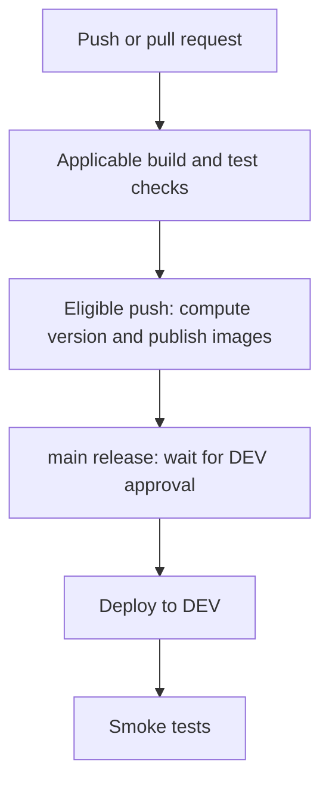
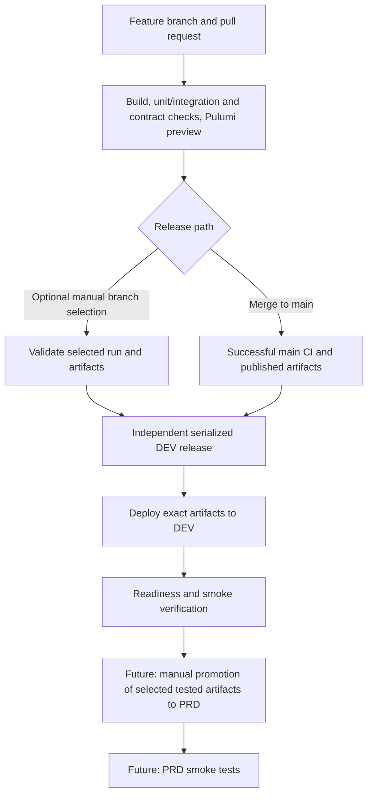

# Deployment Workflow

Status recorded on 2026-10-23. The diagrams distinguish implemented behaviour
from the accepted direction in
[ADR 0006](architecture/decisions/0006-separate-dev-validation-and-deployment.md).

## Current State

The single CI workflow performs validation, publication, DEV deployment, and
smoke checks. Push and pull-request triggers exist, but image build/publication
and Docker integration tests are push-gated. `main` deployment references the
GitHub `dev` environment, currently configured for manual approval. Superseding
runs can cancel the whole CI workflow, including deployment.

The approval rule was used to stop old replicas before the incompatible table
move in release `0.17.4`; it is not general automatic maintenance. That operation
is recorded in [ADR 0005](architecture/decisions/0005-least-privileged-game-state-database-access.md).

## Target State

The target check list is not a claim that contract gating or Pulumi preview is
already wired for every PR. Identify missing checks explicitly during delivery.

## Delivery Boundaries

| Story | Responsibility |
| --- | --- |
| DEV deployment alignment | Independent protected deployment/verification lifecycle, optional authorized branch release, automatic main release, artifact provenance, serialization, shared-schema policy |
| Cost assessment | Estimate permanent/temporary environment costs and realistic scheduling savings |
| DEV operating hours | Future 10:00-22:00 London-time availability, wake-on-deploy, one-hour out-of-hours grace, manual/time-limited keep-awake, shutdown coordination |
| Isolated environments | Separate stable PRD resources, database, credentials, and Pulumi stack |
| Release promotion | Deliberately select and promote the same tested artifact identities to PRD without rebuilding |
| Upgrade and recovery rehearsal | Repeat upgrades from the previous release with representative data in a disposable environment |
| Reusable maintenance | Automate proven procedures for incompatible schema changes when justified |

Feature environments are outside the initial shared-DEV scope. PRD and scheduled
operating hours do not exist yet. Key Vault and a dedicated migrator account
are separate security increments.

## Agreed Release Rules

- Superseded pre-deployment work may be automatically cancelled. An active
  deployment, including future wake-up and its verification, must not be
  automatically cancelled by newer runs. Manual emergency cancellation remains
  possible and may require recovery.
- DEV releases cannot overlap. Define pending-run and stale-release handling;
  do not assume commit-order execution merely because jobs share a concurrency
  group.
- Keep exact CI run, commit, and image identities together. Do not rebuild images
  during release or silently substitute the current tip of a branch.
- Shared DEV branch migrations require review against current `main` and the
  actual applied schema. Record them, leave them applied when images change,
  and reject incompatible/conflicting branch deployments.
- No automatic image or database rollback on failure. Account provisioning and
  EF migrations are separate operations with separate recovery implications.
- After implementation, add operator instructions for manual branch selection,
  release history, failure handling, and the actual GitHub environment policy.
  This target document is not a runnable deployment procedure.
